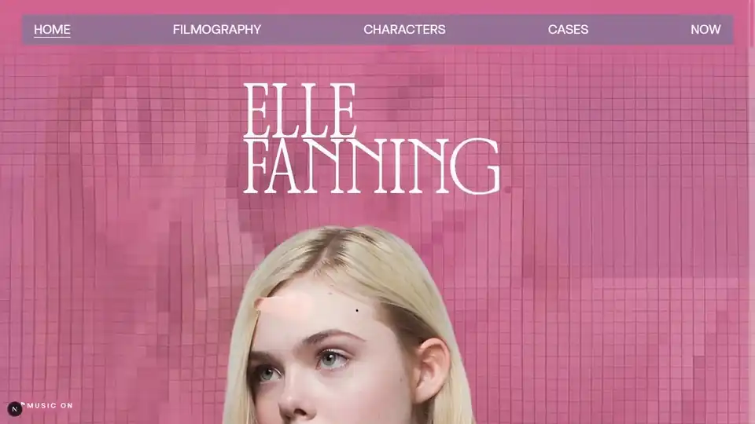
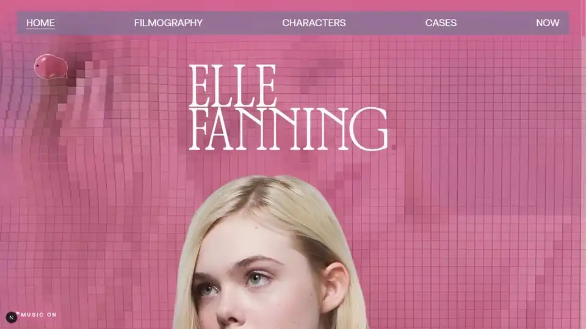
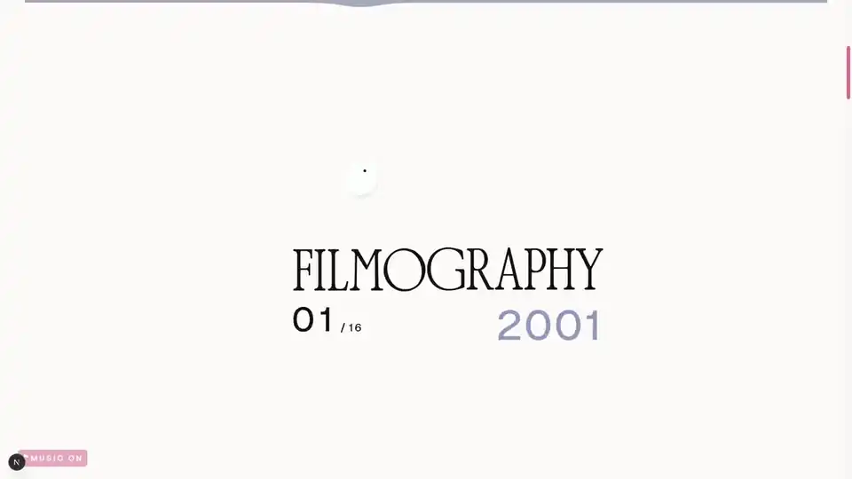
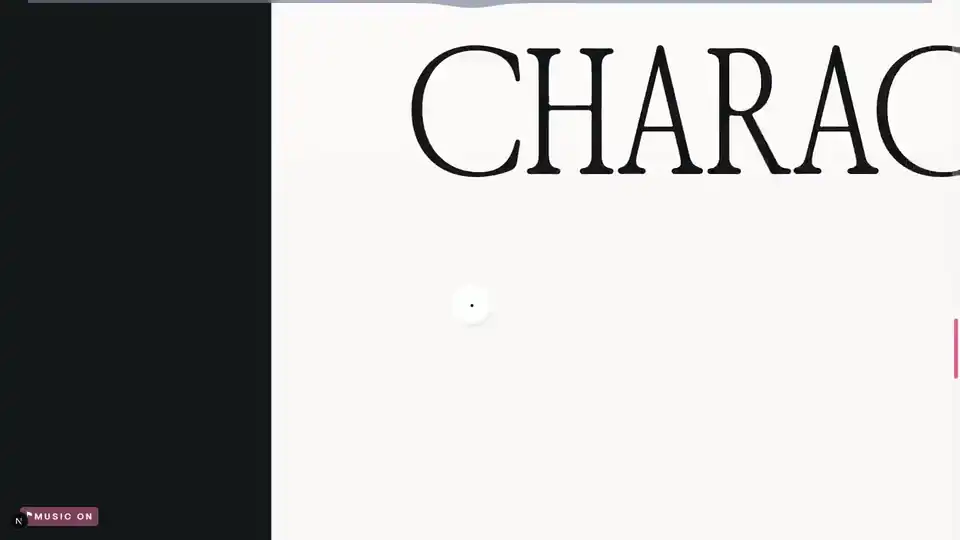
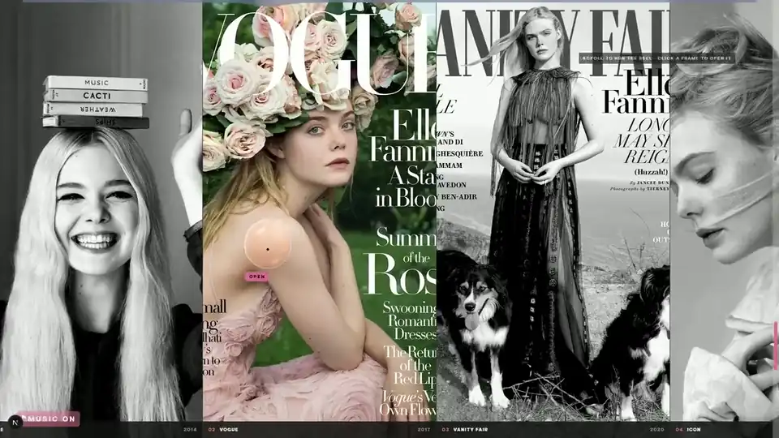
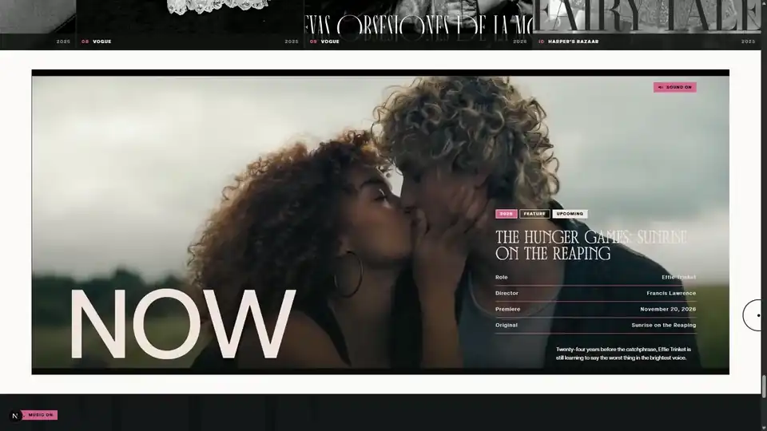

<div align="center">

<a href="https://erikeliasv.github.io/ellefanning-portfolio/">
  
</a>

<br>

# Elle Fanning — Portfolio

**Um portfólio editorial feito por fã, que também é um laboratório de front-end criativo.**

Shaders, física de mola, scroll coreografado e som no navegador, tudo escrito à mão<br>
sobre ferramentas sólidas e muito funcionais.

<br>

<a href="https://erikeliasv.github.io/ellefanning-portfolio/"></a>

<br>
<br>


</div>

<br>

## Por que esse projeto existe

Eu gosto muito da Elle Fanning e do trabalho dela. Da menina de *I Am Sam* à imperatriz de
*The Great*, passando pela Jesse de *The Neon Demon*, pela Alicia de *The Beguiled* e pela Violet
de *Teen Spirit*, é uma carreira cheia de escolhas bonitas, e eu queria um lugar para reunir tudo
isso com o cuidado de um editorial de revista.

Ao mesmo tempo, eu queria um projeto para mostrar, funcionando de verdade, as técnicas que fui
aprendendo: shaders em WebGL, física de mola, animação guiada por scroll, filtros SVG e design de
som no navegador. Não tem template nem construtor visual. Cada efeito foi escrito à mão, com
tecnologias consolidadas e muito funcionais (Next.js, Three.js, GSAP, Lenis) e com as APIs que o
próprio navegador já oferece.

O resultado é um site 100% estático, sem backend, publicado no GitHub Pages a cada push na `main`.

<br>

## O site, seção por seção

> Os vídeos abaixo são as mesmas gravações que o menu do site toca quando você passa o mouse em
> cada link. Os mais longos foram acelerados para caber aqui.

<br>

### `01` HOME



O retrato da Elle sobre um campo rosa de blocos 3D que ondulam sob o cursor. Ao rolar, o nome
cresce, os blocos engrossam e a composição se reorganiza.

- **Milhares de cubos em uma única draw call.** O campo é um `InstancedBufferGeometry` do Three.js:
  cada instância lê a sua célula da foto no *vertex shader* e ganha volume, luz e uma tinta rosa.
- **Onda a partir do ponteiro.** Uma senoide com decaimento exponencial levanta os blocos em volta
  do cursor e lava a tinta, revelando a cor original da foto. A câmera acompanha o mouse e se afasta
  conforme a página desce.
- **Carregamento progressivo.** Um shader 2D em WebGL puro pinta a primeira tela na hora. O Three.js
  é importado sob demanda e assume quando fica pronto. Sem WebGL, sobra uma imagem estática.
- **Cada bloco tem som.** Passar sobre um bloco dispara um grão sonoro com pan estéreo pela posição
  horizontal.
- **Vida própria.** Depois de alguns segundos sem input, um ponteiro fantasma passeia sozinho numa
  curva de Lissajous.

<br>

### `02` FILMOGRAPHY



Dezesseis filmes, de *I Am Sam* (2001) a *A Complete Unknown* (2024). A palavra se abre ao meio e os
pôsteres passam entre FILMO e GRAPHY como um rolo de cinema, com o contador e o ano mudando junto.

- **Palco guiado por scroll.** Uma trilha de scroll é dividida em fases (cortina, entrada, rolo e
  saída) por funções puras em `src/lib/motion/filmStage.ts`. O hook só traduz o progresso em
  `transform`.
- **Profundidade de campo.** Os pôsteres vizinhos encolhem e desfocam conforme se afastam do centro.
- **Catraca sonora.** Cada pôster que trava no centro toca um *tec* de rolo de filme, com pan pela
  posição no rolo.
- **Modal de sinopse** sobre o próprio pôster desfocado, com o resto da página `inert` enquanto ele
  está aberto.
- No celular o rolo vira vertical, com composição própria.

<br>

### `03` CHARACTERS



Oito personagens num leque em arco 3D. A tinta preta sobe, a palavra CHARACTERS assenta e o scroll
gira o deck.

- **Geometria do deck em 3D.** `src/lib/motion/characterDeck.ts` calcula posição, rotação e escala de
  cada carta no arco a partir de um único número de progresso. As cartas da direita entram
  espelhadas, como no desenho do Figma.
- **Tela cheia.** O clique abre a personagem com texto, gênero, créditos e link para o IMDb. A roda
  do mouse fecha.
- **Gestos no celular.** Arrastar para o lado troca a foto, com um detector de swipe próprio em
  `src/lib/swipe.ts`.

<br>

### `04` CASES



Dez ensaios e capas de revista, de *Vogue* 2014 a *Vogue* 2026. O scroll vertical vira um rolo
horizontal, e o clique abre o ensaio.

- **Rolo horizontal.** A roda e o arraste viram pan lateral, com encaixe suave em cada capa e um
  cursor que anuncia *OPEN*.
- **Leitura pelo scroll.** Com o ensaio aberto, a página trava e a roda passa a conduzir a leitura: o
  título gigante, o ano e as fotos do ensaio espalhadas sobre a capa. Ao rolar além do fim, o ensaio fecha
  sozinho e o rolo volta.
- No celular, o scroll e o arraste lateral fazem a mesma coisa.

<br>

### `05` NOW



O que ela está fazendo agora: *The Hunger Games: Sunrise on the Reaping* (2026), com o trailer
servido pelo próprio site.

- O trailer toca quando entra na tela e pausa quando sai.
- **A trilha dá passagem.** Quando o trailer está por perto, a música do site sai num fade para não
  brigar com o som do filme e volta quando você segue adiante.
- O som do trailer só abre depois de um gesto do usuário, como pedem as regras de autoplay dos
  navegadores.

<br>

### `06` Rodapé

A foto da Elle aparece por dentro das letras do nome, através de uma lanterna (uma máscara radial)
que segue o mouse e, parada, varre o nome sozinha. Ali o cursor vira uma seta para cima, e o clique
volta ao topo.

<br>

## O que acompanha a página inteira

### Cursor de vidro líquido

- Um mapa de deslocamento de lente é gerado em um `<canvas>` (curvatura `0.22·r + 0.78·r^4.2`),
  vira um `feDisplacementMap` de SVG e é aplicado via `backdrop-filter`. A página por trás da gota
  é refratada de verdade, com brilho e sombra feitos por `feGaussianBlur`.
- A forma é um path SVG que estica na direção do movimento, como uma gota, guiada por molas
  integradas a cada quadro.
- Cresce sobre links, é atraída por eles e troca de rótulo conforme o contexto.
- A refração roda em navegadores Chromium. Nos outros, o cursor vira um vidro com blur.

### Menu de vidro líquido

- A barra é de vidro (`backdrop-filter` com blur e saturação). Com o mouse em um link, um painel
  abre mostrando o clipe daquela seção através de um shader WebGL: ondas a partir do ponteiro,
  aberração cromática e uma transição líquida de um clipe para o outro.
- Ao descer a página, a barra recolhe até a borda e vira uma gota (um path SVG de metaball) que
  segue o mouse.
- Um scroll-spy marca a seção atual. Depois do load, os clipes são baixados como `blob` para tocar
  na hora, e esse download é pulado em conexões com economia de dados.

### Scroll, som e entrada

- **Lenis e GSAP em um ticker só.** O ticker do GSAP move o Lenis e chama todos os assinantes de
  `onTick`: cursor, menu, palcos e shaders andam no mesmo quadro.
- **Motor de áudio em Web Audio.** Trilha ambiente com reverb por convolução (a resposta ao impulso é
  gerada em código), alargamento estéreo mid/side, pool de vozes para os grãos e os *tecs*, e a
  preferência de som guardada entre visitas.
- **Preloader** que espera as fontes, a imagem de abertura e o `load` da página (mínimo de 1,5 s,
  teto de 6 s). O clique de entrada também é o gesto que libera o áudio.
- **Scrollbar própria**, arrastável.

<br>

## Engenharia

- **Matemática separada do React.** A coreografia mora em funções puras (`src/lib/motion/*`) que
  recebem um progresso e devolvem uma pose. Os hooks só aplicam o resultado, o que deixa as
  animações verificáveis fora do navegador.
- **Do celular ao 4K.** Abaixo de 1024 px cada seção tem composição própria de telefone, medida no
  frame de 402×874 do Figma. Acima de 1920 px o site inteiro escala proporcionalmente, porque cada
  medida fixa é escrita como `calc(N * var(--px))`.
- **Movimento reduzido.** Com `prefers-reduced-motion`, o scroll suave desliga, os palcos ficam mais
  curtos e os shaders param de animar.
- **Leve.** Imagens em WebP, clipes do menu em 1280 px e sem áudio (de 106 MB para 16 MB), Three.js
  importado sob demanda, WebGL pausado fora da tela e densidade de pixels limitada a 2.
- **Estático.** `output: "export"` do Next.js e deploy por GitHub Actions no Pages, com o `basePath`
  derivado do nome do repositório.

<br>

## Stack

| Tecnologia | Papel no projeto |
| --- | --- |
| **Next.js 16** (App Router, export estático) | estrutura, fontes, imagens e build |
| **React 19** + **TypeScript** | componentes e hooks, um hook por mecanismo |
| **Three.js** | o campo de blocos 3D da hero e o líquido do menu |
| **WebGL puro** | o shader 2D que pinta a hero antes de o Three.js chegar |
| **GSAP** | tweens, `quickTo` e coreografia por scroll com ScrollTrigger |
| **Lenis** | scroll suave |
| **Tailwind CSS 4** | tokens de design em `@theme` |
| **Web Audio API** | motor de som: trilha, grãos, *tecs* e reverb |
| **Filtros SVG** | a refração do cursor e a gota do menu |

<br>

## Identidade visual


Os títulos usam a ZT Bros Oskon 90s, uma serifa editorial de capa de revista, e o texto corrido usa
a ZT Nature. Os tokens de cor, tipo e espaçamento vivem em `src/styles/globals.css`, sob `@theme`.

<br>

## Rodando localmente

```bash
npm install
npm run dev      # http://localhost:3000
npm run build    # gera o site estático em out/
```

<br>

## Estrutura

```
public/                 imagens em webp, vídeos, áudio e ícones servidos como estáticos
src/
  app/                  layout, página, ícones e fontes locais
  sections/             uma seção do site por arquivo
  components/
    characters/         palco e modal da seção Characters
    filmography/        palco e modal da Filmografia
    footer/             peças do rodapé
    layout/             chrome global montado no layout (cursor, preloader, scrollbar, som)
    ui/                 peças pequenas compartilhadas
  hooks/                hooks React, um por mecanismo
  data/                 conteúdo do site (filmes, personagens, editorial, links, seções)
  lib/                  utilitários compartilhados (scroll, áudio, reveal, swipe, viewport)
    motion/             matemática pura das animações de cada peça
    webgl/              cenas three.js
  styles/               css global e um arquivo por seção
```

<br>

## Git Flow

`main` estável · `develop` integração · `feature/*` uma por etapa.

<br>

---

<div align="center">

Feito por fã, com muito carinho, por [@ErikEliasV](https://github.com/ErikEliasV).

<sub>Projeto pessoal, sem fins comerciais e sem ligação com Elle Fanning, seus representantes ou
estúdios.<br>Fotos, pôsteres, capas de revista e trechos de filmes pertencem aos seus respectivos
detentores.</sub>

</div>
